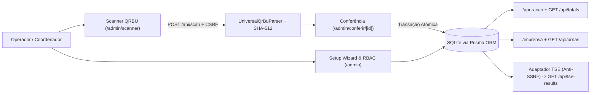

<div align="center">

# Apuração Paralela 2.0

**Plataforma cívica independente e universal para coleta, conferência e totalização paralela de Boletins de Urna (QRBU)**

[](CHANGELOG.md)
[](https://nextjs.org/)
[](https://react.dev/)
[](https://www.typescriptlang.org/)
[](https://tailwindcss.com/)
[](https://www.prisma.io/)
[](https://www.sqlite.org/)
[](https://vitest.dev/)
[](https://playwright.dev/)

</div>

---

## Sobre o Projeto

O **Apuração Paralela 2.0** é uma aplicação web independente, com código-fonte disponível neste repositório, desenvolvida para coletar, verificar criptograficamente, conferir, totalizar e publicar resultados extraídos diretamente dos Boletins de Urna (BUs) físicos impressos nas seções eleitorais brasileiras após o encerramento da votação.

Originado na experiência cívica de acompanhamento eleitoral em Concórdia/SC (v1.0), o projeto foi reestruturado na versão **2.0** para operar como **plataforma universal multi-eleição**, configurável pelo Setup Wizard administrativo para pleitos **Municipais**, **Estaduais**, **Nacionais** ou **Consultas Populares**, com suporte simultâneo a múltiplos cargos, turnos independentes e acompanhamento em estúdio para imprensa e rádios.

> [!IMPORTANT]
> **Aviso de Isenção Institucional:** Esta plataforma é uma iniciativa cívica independente com código-fonte público para fins de transparência técnica. **Não possui qualquer vínculo institucional, técnico ou operacional com o Tribunal Superior Eleitoral (TSE) ou com Tribunais Regionais Eleitorais (TREs)** e **não substitui os resultados oficiais da Justiça Eleitoral**. É essencial distinguir três níveis de verificação:
> 1. **Integridade de conteúdo (SHA-512):** verificada matematicamente sobre o texto do QRBU em relação ao hash informado no envelope;
> 2. **Assinatura digital (`ASSI:` / PKI/ICP-Brasil):** **não** é verificada offline pela plataforma (`sigStatus` permanece `'UNCHECKED'`);
> 3. **Autenticidade/origem de um BU oficial:** os testes automatizados E2E `FASE:O` usam payloads sintéticos de teste com SHA-512 válido, não comprovando assinatura digital oficial nem emissão genuína pelo TSE.

---

## Funcionalidades Principais (v2.0)

- **Modelo Universal Multi-Eleição e Multi-Escopo:** Suporte a eleições `GENERAL`, `MUNICIPAL`, `SUPPLEMENTARY` e `CONSULTA`, abrangências nacional (`BR`), estadual (`UF:*`) e municipal (`MUN:*`) em `ElectionScope`, além de isolamento completo de turnos (`1º` e `2º`) e preservação histórica de pleitos encerrados (`FINISHED`).
- **Setup Wizard Administrativo (`/admin/wizard`):** Criação, edição, rascunho (`DRAFT`) e ativação (`ACTIVE`) de eleições, cargos (`Office`), códigos de pleito (`plei`), turnos (`ElectionRound`), abrangências e sincronização TSE via interface web.
- **Adaptador Universal de QRBU (`UniversalQrBuParser`):** Compatível com múltiplos leiautes VRQR do TSE (`Vrqr4Adapter`, `Vrqr5Adapter`, `Vrqr6Adapter`), reconstrução de boletins fragmentados em múltiplos QR Codes fora de ordem, validação estrita de hash **SHA-512**, checagem de invariantes eleitorais e rejeição automática de boletins não oficiais (`FASE !== 'O'`) fora do modo simulação.
- **Scanner Mobile e Contingência (`/admin/scanner`):** Interface responsiva otimizada para campo com seleção/foco de câmera (`html5-qrcode`), upload de foto do BU e entrada manual de payload para áreas sem conexão estável.
- **Conferência Humana e Trilha de Auditoria (`/admin/conferencia`, `/admin/conferir/[id]`, `/admin/audit`):** Fluxo de dupla verificação antes da publicação de um BU, prevenção atômica contra duplicidade via `deterministicId` (`UNIQUE`), registro em `AuditLog` e exportação contábil CSV (`/api/export?format=csv`).
- **Segurança, RBAC e CSRF Fail-Closed:**
  - Perfis administrativos diferenciados (`ADMIN`, `OPERATOR`, `VIEWER`) geridos em `/admin/usuarios`.
  - Revogação imediata de sessões via `sessionVersion`, proteção fail-closed de `JWT_SECRET` e bloqueio de autoexclusão/rebaixamento do último `ADMIN` ativo.
  - Setup inicial protegido (`scripts/create-initial-admin.mjs` ou `POST /api/setup` condicionado a `ADMIN_SETUP_TOKEN` e desativável por `DISABLE_HTTP_SETUP=true`).
  - Validação CSRF fail-closed (`Origin`/`Referer`/`Sec-Fetch-Site` + token HMAC em `x-csrf-token`) e isolamento estrito de boletins de simulação (`isSimulation = true`).
- **Painel Público Universal (`/apuracao`):** Visualização agnóstica a pleito e cargo com seleção dinâmica (`?election=...&round=...`), votos nominais, de legenda, brancos, nulos, comparecimento, abstenções, cobertura provisória vs homologada e projeção linear provisória.
- **Imprensa & Rádio (`/imprensa`):** Feed em tempo real **Últimas Urnas Apuradas** com paginação por cursor, filtros por Zona/Seção, modal de detalhamento com status SHA-512, geração automática de **roteiro de locução para rádio** e modo **Teleprompter** de alto contraste.
- **Adaptador Dinâmico TSE (`/api/tse-results`):** Consumo dinâmico das parciais oficiais EA20 orientado por `TseSyncConfig` e Setup Wizard, com cache contextual de 15 segundos, bloqueio anti-proxy de parâmetros externos e proteção anti-SSRF multi-camada (validação CIDR IPv4/IPv6, DNS pinning e bloqueio de redirecionamentos `3xx`).

---

## Arquitetura Resumida



Consulte detalhes completos dos modelos e módulos em [`docs/ARCHITECTURE.md`](docs/ARCHITECTURE.md).

---

## Tecnologias Utilizadas

- **Core:** Next.js 16 (App Router), React 19, TypeScript 5
- **Interface:** Tailwind CSS 4, `lucide-react`, `html5-qrcode`, `qrcode.react`
- **Banco e ORM:** Prisma ORM 5 + SQLite (schema alternativo legado PostgreSQL em `prisma/schema.postgresql.prisma`)
- **Validação & Segurança:** `zod`, `jsonwebtoken`, `bcryptjs`, `asn1js`, `pvutils`
- **Qualidade & Testes:** Vitest 2.1 (`happy-dom`), Playwright 1.63, ESLint 9

---

## Instalação e Execução Local

### Pré-requisitos
- **Node.js** 20+
- **npm** 10+
- **Git**

### Passo a Passo

1. **Clonar o repositório e instalar dependências:**
   ```bash
   git clone https://github.com/georgecolossi/apuracao-paralela-2026.git
   cd apuracao-paralela-2026
   npm install
   ```

2. **Configurar variáveis de ambiente:**
   ```bash
   cp .env.example .env
   ```
   Edite `.env` definindo pelo menos `DATABASE_URL="file:./dev.db"` e um `JWT_SECRET` seguro (a aplicação falha fechada caso `JWT_SECRET` não esteja configurado).

3. **Inicializar banco SQLite local e criar o primeiro administrador:**
   ```bash
   npx prisma db push
   node scripts/create-initial-admin.mjs "admin@local.test" "SenhaForteLocal123" "Administrador"
   ```

4. **Executar em modo desenvolvimento:**
   ```bash
   npm run dev
   ```
   - Painel Público: `http://localhost:3000/apuracao`
   - Imprensa & Rádio: `http://localhost:3000/imprensa`
   - Metodologia: `http://localhost:3000/metodologia`
   - Acesso Administrativo: `http://localhost:3000/login`

5. **Build e execução em modo produção:**
   ```bash
   npm run build
   npm start
   ```

---

## Verificações e Testes Automatizados

Todos os testes rodam contra bancos SQLite isolados (`prisma/test.db` e `prisma/e2e.db`), nunca tocando `dev.db` ou bancos operacionais:

```bash
# Auditoria de integridade UTF-8 nos arquivos-fonte e documentação
npm run check:encoding

# Validação do schema Prisma
npx prisma validate

# Checagem estática de tipos TypeScript
npm run typecheck

# Suíte unitária e de integração (Vitest + fixtures oficiais TSE)
npm run test

# Suíte Ponta a Ponta em navegador real (Playwright)
npm run test:e2e

# Análise estática ESLint
npm run lint
```

Detalhes sobre cada suíte e suas limitações estão documentados em [`docs/TESTING.md`](docs/TESTING.md).

---

## Organização do Repositório

```text
├── .env.example                 # Variáveis de ambiente suportadas no runtime e bootstrap
├── CHANGELOG.md                 # Histórico evolutivo até a v2.0.0
├── docs/
│   ├── ARCHITECTURE.md          # Visão arquitetural e modelo de dados v2.0
│   ├── OPERACAO.md              # Manual operacional separado (Local, Homologação, Produção e PR8)
│   ├── TESTING.md               # Estratégia de testes unitários, integração e E2E
│   ├── DEPLOY.md / BACKUP.md    # Diretrizes de implantação e contingência
│   ├── RELEASE_V2.0.0.md        # Notas de lançamento e checklist de publicação v2.0.0
│   └── TSE-2026*.md             # Documentação criptográfica e auditoria de fixtures TSE
├── e2e/                         # Testes E2E Playwright (incluindo e2e/v2-homologation.spec.ts)
├── prisma/                      # Schema Prisma ativo (SQLite), schema legado Postgres, migrações e seeds
├── scripts/                     # Runners isolados de teste, setup CLI, importadores e backup/verify PowerShell
├── src/
│   ├── app/                     # Páginas públicas, área /admin e rotas de API REST
│   ├── components/              # Shell administrativo e sala de imprensa
│   └── lib/                     # Parser QRBU universal, RBAC/CSRF, TSE dinâmico anti-SSRF, totalização e wizard
└── tests/                       # Suítes Vitest e fixtures oficiais/derivadas do TSE
```

---

## Documentação Complementar

- **[Manual Operacional e de Infraestrutura (`docs/OPERACAO.md`)](docs/OPERACAO.md)**
- **[Arquitetura do Sistema (`docs/ARCHITECTURE.md`)](docs/ARCHITECTURE.md)**
- **[Estratégia de Testes (`docs/TESTING.md`)](docs/TESTING.md)**
- **[Notas da Release v2.0.0 (`docs/RELEASE_V2.0.0.md`)](docs/RELEASE_V2.0.0.md)**
- **[Formatos QRBU Suportados (`docs/QRBU-ADAPTER-SUPPORTED-LAYOUTS.md`)](docs/QRBU-ADAPTER-SUPPORTED-LAYOUTS.md)**

---

## Como Contribuir

1. Crie uma branch a partir da branch de integração ativa do ciclo correspondente (nunca envie alterações diretamente para `main`).
2. Mantenha todos os arquivos em UTF-8 limpo (sem caracteres corrompidos ou *null bytes*), preservando comentários existentes fora do escopo alterado.
3. Adicione ou atualize testes automatizados em `tests/` ou `e2e/` cobrindo qualquer alteração comportamental.
4. Execute `npm run check:encoding`, `npm run typecheck`, `npm run test`, `npm run test:e2e`, `npm run build` e verifique que novos arquivos não introduzem violações no `npm run lint`.
5. Abra Pull Request com descrição clara de escopo, riscos, limitações conhecidas e evidências de execução dos testes.

---

## Licença

O código-fonte deste projeto encontra-se disponível neste repositório, porém **ainda não há um arquivo `LICENSE` definido no diretório raiz**. A definição formal dos termos de licenciamento permanece pendente de escolha e aprovação expressa pelo mantenedor do projeto antes da eventual publicação da release `v2.0.0`.
