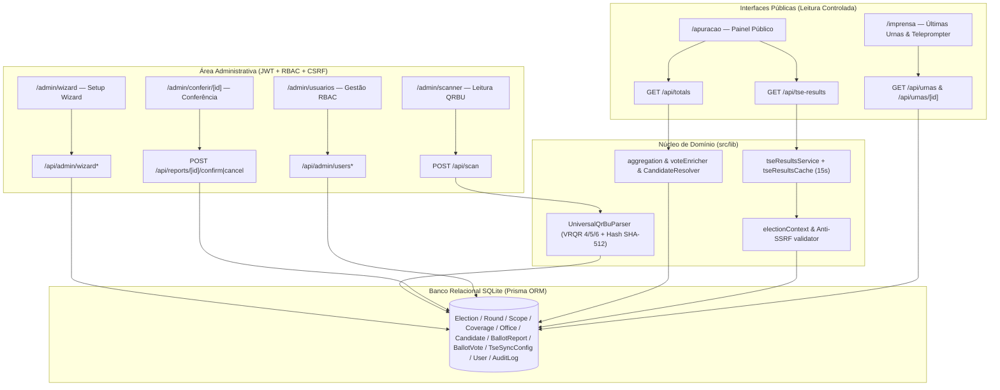

# Arquitetura do Sistema — Apuração Paralela 2.0

Este documento descreve a arquitetura técnica atual do **Apuração Paralela 2.0** (release `v2.0.0`), construída para operar de forma universal e configurável para qualquer eleição brasileira (municipal, estadual, nacional ou consulta popular), mantendo rastreabilidade criptográfica e isolamento estrito entre contextos eleitorais e turnos.

---

## 1. Stack Tecnológica

| Camada | Tecnologia | Observações |
| :--- | :--- | :--- |
| **Framework Full-Stack** | Next.js 16 (App Router) + React 19 + TypeScript 5 | Rotas SSR/Client, App Route Handlers (`/api/*`) e Middleware de autenticação |
| **Estilização** | Tailwind CSS 4 + `lucide-react` | Interface responsiva para mobile em campo (`/admin/scanner`), painéis e estúdio (`/imprensa`) |
| **Persistência e ORM** | Prisma ORM 5 (`prisma/schema.prisma`) | **SQLite** como runtime padrão (`file:./dev.db` local, `/data/prod.db` em produção com volume persistente); há esquema legado alternativo PostgreSQL em `prisma/schema.postgresql.prisma` |
| **Leitura e Decodificação QRBU** | `html5-qrcode` + Adaptador `UniversalQrBuParser` | Suporte a múltiplos leiautes VRQR (`Vrqr4Adapter`, `Vrqr5Adapter`, `Vrqr6Adapter`), reconstrução multipartes e validação SHA-512 |
| **Autenticação e Segurança** | `jsonwebtoken` + `bcryptjs` + HMAC-SHA256 | JWT em cookie `HttpOnly` com `sessionVersion`, RBAC (`ADMIN`, `OPERATOR`, `VIEWER`) e proteção CSRF fail-closed |
| **Atualização em Tempo Real** | Polling HTTP (`Cache-Control: no-store`) + utilitário SSE (`src/lib/realtime.ts`) | `/api/totals`, `/api/urnas` e `/api/realtime` |
| **Qualidade e Testes** | Vitest 2.1 + Happy DOM + Playwright 1.63 | Testes unitários/integração isolados em `test.db` e suíte E2E em `e2e.db` |

---

## 2. Fluxo Arquitetural Ponta a Ponta



---

## 3. Modelo de Dados Universal (`prisma/schema.prisma`)

- **Contexto Eleitoral e Abrangência:**
  - `Election` (`status`: `DRAFT`, `ACTIVE`, `FINISHED`, `ARCHIVED`; `type`: `GENERAL`, `MUNICIPAL`, `SUPPLEMENTARY`, `CONSULTA`).
  - `ElectionRound` (`roundNumber`: `1` ou `2`; `plei`; `status`: `PLANNED`, `ACTIVE`, `FINISHED`; governança de cobertura em `coverageStatus`).
  - `ElectionScope` (`scopeType`: `NACIONAL`, `ESTADUAL`, `MUNICIPAL`; `scopeKey` único por eleição).
  - `TseSyncConfig`: configuração dinâmica por eleição, turno, cargo (`officeCode`), código oficial (`officialElectionCode`), UF, município e `sourceUrl`.
- **Malha Geográfica e Cobertura por Turno:**
  - `State` -> `Municipality` -> `PollingZone` -> `PollingSection` -> `PollingStation`.
  - `RoundCoverage` (`electionRoundId`, `pollingSectionId`, `expectedBUs`): vincula seções esperadas independentemente por turno; seções agregadas possuem `expectedBUs = 0` e/ou `isAggregated = true`.
- **Cargos, Candidatos e Votos:**
  - `Office` (`code`, `name`, `type`: `MAJORITARIO` / `PROPORCIONAL`, `orderNumber`), `Party`, `Candidate` (`@@unique([officeId, candidateNumber])`) e `CandidateMetadata`.
  - `ScanSession`, `BallotReportPart` (fragmentos QRBU), `BallotReport` (trava determinística `@unique` em `deterministicId`, além de `hashStatus`, `sigStatus`, `status`, `isSimulation`) e `BallotVote`.
- **Segurança e Auditoria:**
  - `User` (`role`: `ADMIN`, `OPERATOR`, `VIEWER`; `isActive`, `sessionVersion`), `AuditLog` e `ProcessingError`.

---

## 4. Núcleo de Segurança e Isolamento

1. **Autenticação Fail-Closed e Rate Limiting (`src/lib/auth.ts`, `src/lib/security/loginRateLimiter.ts`):** Exige `JWT_SECRET` configurado no ambiente. Tokens carregam `userId`, `role` e `sessionVersion`, validados no banco a cada requisição administrativa. `POST /api/login` aplica equalização de tempo via `bcrypt` para contas inexistentes/inativas (anti-enumeração) e controle transacional com **reserva síncrona pré-DB/bcrypt** (impedindo corridas TOCTOU, com liberação garantida em `finally`). Reservas de janelas expiradas que ainda estejam em voo (`pending > 0`) são aposentadas em tabela separada por `epochId` (`retiring`), impedindo sobrescrita de gerações e interferência entre janelas. Com `LOGIN_TRUSTED_PROXY_HOPS >= 1` e sufixo `X-Forwarded-For` posicionalmente válido da direita para esquerda (sem filtrar entradas inválidas), aplica buckets independentes `(IP, conta)` (5/15 min) e `IP` (20/15 min). Com `LOGIN_TRUSTED_PROXY_HOPS=0` (ou cabeçalho inválido/ausente), aplica fallback individual por conta (`5/15 min`): cinco falhas podem bloquear temporariamente aquela conta mesmo a partir de fontes distintas — isso elimina bloqueios coletivos entre contas, mas não impede DoS direcionado contra uma conta específica; a contagem de proxies confiáveis deve ser validada empiricamente no ambiente alvo antes de depender da limitação por IP. Sob saturação da store primária (`10.000` entradas), bloqueios ativos e reservas pendentes nunca são evictados; o excesso usa tabela de overflow com endereçamento aberto (`256` slots por escopo) preservando a identidade integral da chave (sem colisão nem limpeza cruzada) e política fail-closed (`429`) quando todos os 256 slots do escopo estão ocupados por bloqueios/reservas ativas. Estado volátil em memória por instância Node.js.
2. **Controle de Acesso Baseado em Papéis (RBAC):**
   - `ADMIN`: Setup Wizard, gestão de usuários/sessões, ativação de turnos, cobertura, reset operacional (quando habilitado), scanner e conferência.
   - `OPERATOR`: scanner de QRBU (`/admin/scanner`) e conferência de boletins (`/admin/conferencia`, `/admin/conferir/[id]`).
   - `VIEWER`: leitura restrita conforme regras das rotas administrativas.
3. **Proteção CSRF (`src/lib/security/csrf.ts`):** Mutações autenticadas exigem validação de `Origin`/`Referer`/`Sec-Fetch-Site: same-origin` ou token HMAC em `x-csrf-token` obtido via `GET /api/csrf-token`. Em produção, protocolos não-HTTPS e hosts fora da lista confiável (`APP_URL`, `NEXT_PUBLIC_APP_URL`, `RAILWAY_PUBLIC_DOMAIN`) são bloqueados.
4. **Blindagem de Ingestão (`POST /api/scan`):** Rejeita payloads não oficiais (`FASE !== 'O'`), a menos que `isSimulation: true` ou `ALLOW_SIMULATED_FASE=true` esteja explicitamente definido; verifica integridade SHA-512, cobertura territorial e invariantes de votação (`BALLOT_INVARIANT_*`); garante atomicidade contra duplicidade via erro `P2002` no `deterministicId`.
5. **Segregação Estrita de Simulação e Contexto:** Relatórios com `isSimulation = true` nunca contaminam `/api/totals` nem `/api/urnas` oficiais; eleições `DRAFT` e `ARCHIVED` retornam HTTP `403` (`CONTEXTO_NAO_AUTORIZADO`) em todos os endpoints públicos (`/api/totals`, `/api/urnas`, `/api/urnas/[id]`, `/api/tse-results`), permanecendo acessíveis (`200`) apenas contextos `ACTIVE` e `FINISHED`.
6. **Anti-SSRF no Adaptador TSE (`src/lib/validation/electionContext.ts` e `src/lib/tse/tseResultsService.ts`):** Bloqueia sobrescrita de parâmetros via query string (`PARAMETRO_NAO_PERMITIDO`), impõe HTTPS em produção, filtra intervalos IPv4/IPv6 reservados/privados/loopback/CGNAT/link-local em formatos alternativos, resolve DNS com validação completa e fixa IPs no socket (`executePinnedHttpGetJson`) com bloqueio de redirecionamentos `3xx`.

---

## 5. Estrutura de Diretórios

```text
├── prisma/                  # Schema SQLite ativo, schema PostgreSQL legado, migrações e seeds
├── scripts/                 # Execução isolada de testes/E2E, bootstrap admin, importadores e backups PS1
├── src/
│   ├── app/
│   │   ├── admin/           # Painel administrativo (wizard, turnos, cobertura, usuarios, scanner, conferir, audit)
│   │   ├── api/             # Endpoints REST públicos e administrativos + SSE realtime
│   │   ├── apuracao/        # Painel público universal e comparativo oficial TSE
│   │   ├── imprensa/        # Feed "Últimas Urnas Apuradas" e modo Teleprompter/Rádio
│   │   ├── login/           # Autenticação administrativa
│   │   └── metodologia/     # Transparência matemática e critérios de auditoria
│   ├── components/          # Shell administrativo, componentes da sala de imprensa e modais
│   └── lib/
│       ├── aggregation/     # Motor de totalização e projeção
│       ├── crypto/          # Utilitários criptográficos
│       ├── db/              # Singleton Prisma Client
│       ├── metadata/        # Resolução e enriquecimento de candidatos/partidos
│       ├── parser/          # Adaptador universal VRQR 4/5/6 + validação SHA-512
│       ├── presentation/    # DTOs públicos, paginação por cursor e roteiros para rádio
│       ├── scanner/         # Gestão de câmera, multipartes e tratamento de erros QRBU
│       ├── security/        # Proteção CSRF fail-closed
│       ├── tse/             # Adaptador dinâmico EA20 e cache contextual (15s)
│       ├── validation/      # Contexto eleitoral, URLs anti-SSRF e políticas de senha
│       └── wizard/          # Persistência e ativação via Setup Wizard
├── tests/                   # Suítes Vitest (unitários, integração e fixtures oficiais TSE) + fixtures em tests/fixtures/
└── e2e/                     # Suítes Playwright Ponta a Ponta
```
