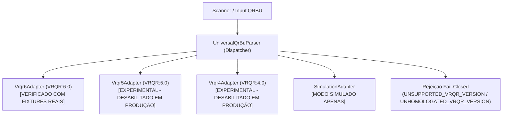
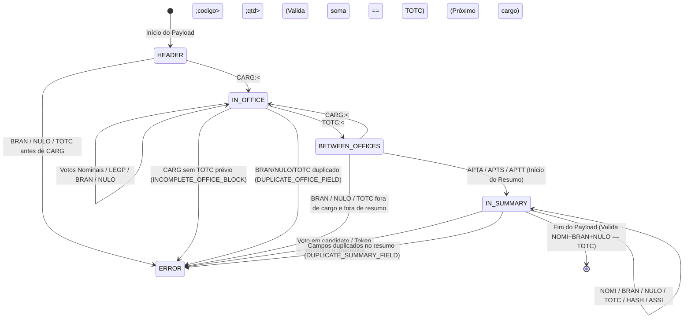

# APURAÇÃO PARALELA 2.0 — ADAPTADORES UNIVERSAIS DE QRBU E MATRIZ DE FORMATOS

**Repositório:** `georgecolossi/apuracao-paralela-2026`  
**Módulo:** `src/lib/parser/adapter`  
**Data:** 28 de Outubro de 2026  
**Status da Auditoria Independente:** PR #15 — Reauditoria Concluída  

---

## 1. DELIMITAÇÃO DE ESCOPO: COMPATIBILIDADE TÉCNICA VS HOMOLOGAÇÃO TSE

> [!IMPORTANT]
> **Esclarecimento Institucional e Metodológico:**  
> A classificação de um layout como **"Homologado para Ingestão"** neste sistema refere-se **exclusivamente à conformidade técnica, criptográfica e semântica verificada internamente pela suíte de testes automatizados contra arquivos e amostras oficiais reais disponibilizadas pelo TSE**.  
> O projeto Apuração Paralela é uma iniciativa independente da sociedade civil e **não possui vínculo, chancela, auditoria prévia ou convênio oficial com o Tribunal Superior Eleitoral (TSE)**.  
> Nenhum resultado de verificação com fixtures de uma versão específica de layout (ex.: VRQR 6.0) pode ser extrapolado para outros layouts (VRQR 5.0, 4.0, 3.0), nem para pleitos, sistemas operacionais ou configurações de urnas eletrônicas não testados e não demonstrados formalmente.

---

## 2. VISÃO GERAL DA ARQUITETURA DE ADAPTADORES

A versão 2.0 da Apuração Paralela desacopla a ingestão, reconstrução e interpretação de Boletins de Urna (BUs) de regras fixas ou cronológicas de 2026. A arquitetura adota o padrão *Strategy / Registry* modular com política estrita *fail-closed*:

---

## 3. MATRIZ DE CLASSIFICAÇÃO E COMPATIBILIDADE DE FORMATOS

| Versão / Formato | Eleições de Referência | Status no Sistema | Ingestão Oficial por Padrão | Documentação & Evidências Oficiais | Regras Específicas de Cargos |
| :--- | :--- | :---: | :---: | :--- | :--- |
| **VRQR:6.0** (`6.0`, `06.00`) | Eleições Municipais 2024 e Gerais 2026 | **HOMOLOGADO INTERNAMENTE** | **HABILITADA** | **10 Fixtures Oficiais do TSE em disco** (`tests/fixtures/tse-2026/official/examples/`). Verificadas com SHA-256 e SHA-512 dos manifests. | Suporta cargos federais, estaduais e municipais (1 a 13, 53). Votos nominais e de legenda partidária (`LEGP`). |
| **VRQR:5.0** (`5.0`, `05.00`) | Eleições Gerais 2022 | **EXPERIMENTAL** | **DESABILITADA** *(Exige `ALLOW_EXPERIMENTAL_VRQR=true`)* | Documentado na Resolução TSE nº 23.673/2022. Código implementado, porém **pendente de pacote de fixtures oficiais reais com SHA-512 em disco**. | Restrito a cargos gerais (1 a 8, 53). Rejeita cargos municipais com `INVALID_OFFICE_FOR_LAYOUT`. |
| **VRQR:4.0** (`4.0`, `04.00`) | Eleições Municipais 2020 | **EXPERIMENTAL** | **DESABILITADA** *(Exige `ALLOW_EXPERIMENTAL_VRQR=true`)* | Documentado nas especificações TSE 2020. Código implementado, porém **pendente de pacote de fixtures oficiais em disco**. | Restrito a cargos municipais (11, 12, 13, 53). Rejeita cargos gerais com `INVALID_OFFICE_FOR_LAYOUT`. |
| **SIMULATION** | Cargas de teste e demonstração | **HOMOLOGADO P/ SIMULAÇÃO** | **RESTRITA AO MODO SIMULADO** | Testes automatizados em modo simulado (`isSimulation: true`). | Validação determinística de simulação. `hashStatus` registrado como `UNAVAILABLE`, sem mascaramento de autenticidade. |
| **VRQR:3.0** | Eleições Gerais 2018 | *NÃO SUPORTADO* | **BLOQUEADA** | Sem pacote de fixtures oficiais com SHA-512 em disco. | Rejeição imediata com `UNSUPPORTED_VRQR_VERSION`. |
| **VRQR:2.0** | Eleições Municipais 2016 | *NÃO SUPORTADO* | **BLOQUEADA** | Sem especificação técnica de hash multipartes consolidada. | Rejeição imediata com `UNSUPPORTED_VRQR_VERSION`. |
| **VRQR:1.0** | Eleições Gerais 2014 | *NÃO SUPORTADO* | **BLOQUEADA** | Primeira iteração experimental (descontinuada pelo TSE). | Rejeição imediata com `UNSUPPORTED_VRQR_VERSION`. |
| **FORMATO_ASN1_BINARIO** | Arquivos de Log / RDV / BU interno | *NÃO APLICÁVEL* | **NÃO APLICÁVEL** | Arquivos gravados em mídia física de urna, não no QR Code impresso no papel. | Assinatura ICP-Brasil em arquivos binários ASN.1 BER/DER. Fora do escopo do scanner óptico. |

---

## 4. CONJUNTO OFICIAL DE FIXTURES DE VRQR 6.0 (EVIDÊNCIAS AUDITÁVEIS)

A verificação do layout **VRQR 6.0** é comprovada contra **10 conjuntos oficiais reais** provenientes de urnas eletrônicas homologadas pelo TSE (modelos UE2013, UE2015, UE2020 e UE2022), armazenados no repositório em `tests/fixtures/tse-2026/official/examples/`:

| Diretório da Fixture | Modelo de Urna / Pleito | Partes | Arquivo da Parte | Tamanho | SHA-256 do Arquivo | Hash SHA-512 Oficial do BU (TSE) |
| :--- | :--- | :---: | :--- | :---: | :--- | :--- |
| `Pres-T2_s02202ac0139200090013-imgbu` | Urna UE2020 / Presidente T2 | 1 | `qrbu-01-of-01.txt` | 846 B | `50e07bf686b40416d792c42e74ce9400ed3e3b414c0c1de3d86e43154d9e2033` | `AB6D80A1362854303FDD92EA5D96CCDB54C2566058A8022CD59254FF7491AA8BC27BC9C985D5A86EF9DC040A4C95CBA58450B692DD8DF1B81936046B223E83C6` |
| `PresGov-T2_s02200ac0139200090013-imgbu` | Urna UE2020 / Pres + Gov T2 | 1 | `qrbu-01-of-01.txt` | 954 B | `3fad23d7d306d33fbb1cf6667f6df7b4917d0f791ac5a1d59eca7f7b36d24fef` | `12E43BC57E5B6D8644A88647EC0610163D52619DAD947872C92765DCBEDC3624F6F399C5F6429DFCDCCCD6CA7B05FCEB05BC162DEF39F254822A93114AD4A11C` |
| `PresGovConMunic-T2_s02120ac0139200090013-imgbu` | Urna UE2020 / Pres + Gov + Consulta | 1 | `qrbu-01-of-01.txt` | 1056 B | `b40ecd2fa9009c8ddf4591e77d246e69e8c5749f7c13292be6a6156dd5744a0d` | `8D5008D02A1ED7DA869B69479AF94FE1D54F919C558792DE0F2C6FFCD2660FD6F087A54EE56ED698F3428FCF4F23A410E9A238D0A1C0CEC0A9C3404CEC52AD3E` |
| `PresGovPrefeito-T2_s18153sp6665603020018-imgbu` | Urna UE2020 / Pres + Gov + Prefeito | 1 | `qrbu-01-of-01.txt` | 1064 B | `2cea9622476bd175d4761484722f7274dc5594dd962ba342d85e808efa7c2f6d` | `FB6C78EAF84DCD45EB3D4ACFA055A6697BE97E8923173F507321F51277A10EEB75FC18604F50D9CEB2DC359CE39431F5190EB58E0DBE81B3DA7C3DC001BE961B` |
| `RED_s02110ac0139200090110-imgbu` | Urna RED / Eleição Completa | 2 | `qrbu-01-of-02.txt` `qrbu-02-of-02.txt` | 967 B 603 B | `01ac646931e0f4780b2ecfd5362c791078070f85e542d3b5ff2c93eb969de71b` `0a5088dc27e35bcffce72bdfd5e88eee15fc94f327c5eb47153cc1c3bb958428` | `F912C2115AB30B0AD5D860C0C988341407A88C6501FD3415610B99105395F3CBBC9BA30E4D76E9BCACA04F79CE496E87973580DCE66A723D04626EB9A78DE67C` |
| `s02110ac0139200090110-imgbusa` | Urna Seção Especial / Completa | 2 | `qrbu-01-of-02.txt` `qrbu-02-of-02.txt` | 972 B 545 B | `bd19dc06d9717c67e61035520740ab83c4c1a47974fb55eda9a722470f52589d` `950d48fbb7da2dee731bc40262cd0d58833757b70c7317171e254b575b9a3a4b` | `7F05A61002E8132A9455D785B1B9A584E6C639FBD02954E1B5175229C1DD5D8073FCC27416481014B2A7D3BF45FBD810C63E3A6A0785B9E083296331BE54E28A` |
| `UE2013_s02110ac0139200090110-imgbu` | Urna Modelo UE2013 | 2 | `qrbu-01-of-02.txt` `qrbu-02-of-02.txt` | 970 B 589 B | `2a670f024a4603e368e626664ad65d351906efe5b8b70fc36288319e369d92b0` `5d638b4f34a7e67aed14221b39601f6df521c0c0afb2dddd4049b91f65ed09b0` | `D8E4C286DF3707EA1C5685EC8A0D441C065C7D14804C3C660D15AEAF85386C50549A45DE8D168EDBDBC4DACE06D11B58218C51ADBA49585FAD1CA9FA0E5259D5` |
| `UE2015_s02110ac0139200090110-imgbu` | Urna Modelo UE2015 / Dep Fed (Legenda) | 2 | `qrbu-01-of-02.txt` `qrbu-02-of-02.txt` | 974 B 604 B | `0310e8ce33b79407c39e45acee5a860dc1bb331bc0649a4625527e5d238aed39` `cd7e9d9d4872c314b9e0985dd7a55d572b9268c41586835f6b876315bed1aa36` | `F38A533BC64C5D2C9C249F8190F483A7283F8891183D0CFC60ADBA25A501A1E80AEF5A92DFCFDAED960CDC1F4DF3186DACCB5310136E900A7B896742EF751673` |
| `UE2020_s02110ac0139200090110-imgbu` | Urna Modelo UE2020 | 2 | `qrbu-01-of-02.txt` `qrbu-02-of-02.txt` | 971 B 608 B | `02d99a8b1e15a22e7cde6f5650cff43d12d626a693edfbe0ed68da1c614deac4` `3aece667d3f8a7eee98486c8de6d5dfbc6d01732e98c94009f8c2419ad14d968` | `66CB256960B8EF374BC68ED5FAB673443ABA6F60EDCAF198C78398A73DEEC999CD9E6E2CBAE1A5E776B364CC7BA32D5D7ACFC9E167541A0D0A0EA3D0AB756B35` |
| `UE2022_s02110ac0139200090110-imgbu` | Urna Modelo UE2022 | 2 | `qrbu-01-of-02.txt` `qrbu-02-of-02.txt` | 969 B 575 B | `d59f3ce3199cee3d0b50762ead10289ae0344ec1b8c9d3c693656bccba195542` `dd86d0a199726a7eea3526f3b6df712bc438f287b5ccceb53ec0e0eba7f16d24` | `7AFBBB44E39729405233369036EF8972274570B5026A56EED42C3051C2C390631DEAA1DF7C5791F67C3F4D1FB95BA4E8F38F16DCD9CA67C6EEA1F56125CFEA18` |

---

## 5. ESPECIFICAÇÃO DO CÁLCULO DE SHA-512 (VRQR 6.0)

O algoritmo de verificação de integridade oficial do TSE para **VRQR 6.0** segue estritamente os passos auditáveis:

1. **Ordenação:** As partes são indexadas a partir de `QRBU:N:X` e ordenadas numericamente de `1` até `X`.
2. **Higienização de Envelope:** De cada parte, remove-se o envelope `^QRBU:\d+:\d+\s+(VRQR:\S+\s+)?`.
3. **Truncamento de Hash:** Exclusivamente na última parte (`N === X`), descarta-se da ocorrência do token ` HASH:` (ou `HASH:`) em diante.
4. **Concatenação:** As partes processadas são unidas por exatamente um caractere de espaço (`' '`).
5. **Digest SHA-512:** O texto resultante é codificado em UTF-8 e submetido ao algoritmo SHA-512 (`crypto.createHash('sha512')`).
6. **Comparação em Tempo Constante:** O digest hexadecimal resultante (128 caracteres em maiúsculas) é comparado ao campo `HASH:` original via `crypto.timingSafeEqual`, evitando *timing attacks*.

---

## 6. ESTRUTURAÇÃO GRAMATICAL FAIL-CLOSED: CARGOS VS RESUMO DO BU

A interpretação de tokens eleitorais adota uma máquina de estados finita estrita, sem descarte silencioso:

1. **Tokens em Cargo Ativo (`IN_OFFICE`):**
   - Votos em branco (`BRAN`) e nulos (`NULO`) pertencem ao cargo ativo. Se repetidos no mesmo cargo, geram erro `DUPLICATE_OFFICE_FIELD`.
   - O cargo encerra-se estritamente com `TOTC`. A soma dos votos nominais, legenda, brancos e nulos deve coincidir com `TOTC`, sob pena de `VOTE_TOTAL_MISMATCH`.
2. **Tokens Fora de Cargo (`HEADER` ou `BETWEEN_OFFICES`):**
   - Votos nominais, de legenda, brancos ou nulos encontrados fora de um cargo ativo e fora do resumo do BU são rejeitados com `DISPLACED_VOTE_TOKEN`.
3. **Bloco de Resumo Global do BU (`IN_SUMMARY`):**
   - Inicia-se formalmente após `APTA` (ou `APTS`/`APTT`).
   - Gramática expressamente autorizada: `APTA`, `APTS`, `APTT`, `NOMI`, `LEGC`, `BRAN`, `NULO`, `TOTC`, `HASH`, `ASSI`, `CERT`, `HIQT`, `HICA`, `IDEL`, `PLEI`.
   - Os totais de `NOMI`, `BRAN` e `NULO` são acumulados no resumo e confrontados com `TOTC` do resumo (`SUMMARY_TOTAL_MISMATCH`). Nenhum voto vaza para o cargo anterior e nenhum token é descartado arbitrariamente.

---

## 7. SEPARAÇÃO RIGOROSA: HASH (INTEGRIDADE) VS ASSINATURA (AUTENTICIDADE)

1. **Integridade de Conteúdo (`hashStatus`):**
   - Validada em tempo real via SHA-512.
   - Status: `VERIFIED` quando coincide; `INVALID` quando adulterado, malformado ou truncado.
   - O campo `HASH` é **obrigatório** em layouts oficiais. Se ausente em ingestão oficial, a requisição é rejeitada com HTTP 400 `CRYPTOGRAPHIC_INTEGRITY_FAILED`.
2. **Autenticidade de Assinatura Digital (`sigStatus`):**
   - A assinatura digital (`ASSI:`) utiliza criptografia assimétrica da chave privada da urna eletrônica.
   - As chaves públicas e certificados oficiais do TSE são distribuídos **fora de banda** e não constam no QR Code impresso.
   - O sistema **JAMAIS** declara a assinatura como verificada sem os certificados oficiais da cadeia ICP-Brasil. O status permanece fixado em `UNAVAILABLE`, com nota explicativa auditável registrada em `sigValidationNote`.

---

## 8. ISOLAMENTO ELEITORAL E AUDITORIA DURÁVEL DE REJEIÇÕES

1. **Catálogo Estrito de Cargos:**
   - Nenhum cargo desconhecido é criado automaticamente durante o escaneamento do BU (`tx.office.create` removido).
   - Se o BU contiver cargos não cadastrados na eleição ativa, a transação sofre rollback total e a ingestão é rejeitada com HTTP 422 `OFFICE_NOT_CONFIGURED`.
2. **Auditoria Durável Pós-Rollback:**
   - A transação reverte integralmente, garantindo zero persistência de `BallotReport` ou `BallotVote`.
   - Após o rollback, um registro independente é inserido em `AuditLog` com `action: 'SCAN_OFFICE_NOT_CONFIGURED'`, `result: 'REJECTED'`, identificadores do cargo e pleito, sem registrar senhas, tokens ou cookies.
   - Se a persistência da auditoria falhar, o BU é rejeitado com HTTP 500 `AUDIT_LOG_FAILED`, preservando a segurança fail-closed da plataforma.
