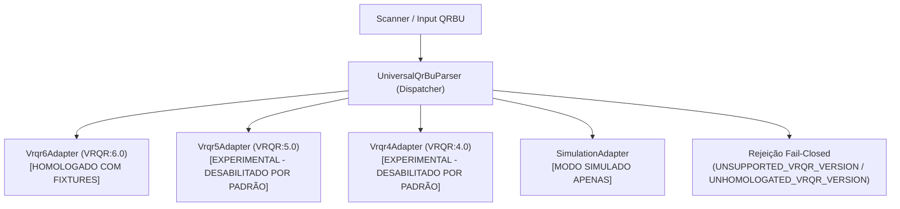

# APURAÇÃO PARALELA 2.0 — ADAPTADORES UNIVERSAIS DE QRBU E MATRIZ DE FORMATOS

**Repositório:** `georgecolossi/apuracao-paralela-2026`  
**Módulo:** `src/lib/parser/adapter`  
**Data:** 28 de Outubro de 2026  
**Status da Auditoria Independente:** PR #15 — Revisão P0/P1  

---

## 1. VISÃO GERAL DA ARQUITETURA DE ADAPTADORES

A versão 2.0 da Apuração Paralela desacopla a ingestão, reconstrução e interpretação de Boletins de Urna (BUs) de regras fixas ou cronológicas de 2026. A arquitetura adota o padrão *Strategy / Registry* modular com política estrita *fail-closed*:

---

## 2. MATRIZ DE CLASSIFICAÇÃO E COMPATIBILIDADE DE FORMATOS

Conforme determinação da Auditoria Independente, nenhum layout é declarado como homologado sem documentação técnica aplicável E fixtures oficiais reais verificáveis em disco com hashes independentes:

| Versão / Formato | Eleições de Referência | Status de Homologação | Ingestão Oficial por Padrão | Documentação & Evidências Oficiais | Algoritmo Criptográfico & Notas |
| :--- | :--- | :---: | :---: | :--- | :--- |
| **VRQR:6.0** (`6.0`, `06.00`) | Eleições Municipais 2024 e Gerais 2026 | **HOMOLOGADO** | **HABILITADA** | **10 Fixtures Oficiais do TSE em disco** (`tests/fixtures/tse-2026/official/examples/`). Verificadas com SHA-256 de origem dos PDFs/DATs e SHA-512 nos manifests. | SHA-512 sobre partes ordenadas concatenadas sem cabeçalho e sem campo final de hash. Votos majoritários, proporcionais e consulta popular. |
| **VRQR:5.0** (`5.0`, `05.00`) | Eleições Gerais 2022 | **EXPERIMENTAL / PENDENTE** | **DESABILITADA** *(Exige `ALLOW_EXPERIMENTAL_VRQR=true`)* | Documentado na Resolução TSE nº 23.673/2022. Código implementado com regras de cargos gerais (1 vaga p/ Senador em 2022). **Pendente de fixtures oficiais reais com SHA-512 em disco.** | SHA-512 acumulado multipartes. Bloqueia cargos municipais. Ingestão oficial bloqueada até obtenção de pacote oficial de fixtures. |
| **VRQR:4.0** (`4.0`, `04.00`) | Eleições Municipais 2020 | **EXPERIMENTAL / PENDENTE** | **DESABILITADA** *(Exige `ALLOW_EXPERIMENTAL_VRQR=true`)* | Documentado nas especificações TSE 2020. Código implementado com restrição a cargos municipais (11, 12, 13, 53). **Pendente de fixtures oficiais em disco.** | SHA-512. Rejeita cargos federais/estaduais. Ingestão oficial bloqueada por padrão. |
| **SIMULATION** | Cargas de teste e demonstração | **HOMOLOGADO P/ SIMULAÇÃO** | **RESTRITA AO MODO SIMULADO** | Testes de integração em modo simulado (`isSimulation: true`). | Validação determinística de simulação. Hash status marcado como `SIMULATED`, nunca mascarado como `VERIFIED`. |
| **VRQR:3.0** | Eleições Gerais 2018 | *PENDENTE / NÃO SUPORTADO* | **BLOQUEADA** | Aguardando pacote oficial de fixtures TSE e especificação pública consolidada. | Rejeição explícita com `UNSUPPORTED_VRQR_VERSION`. |
| **VRQR:2.0** | Eleições Municipais 2016 | *PENDENTE / NÃO SUPORTADO* | **BLOQUEADA** | Sem especificação técnica pública de hash multipartes consolidada. | Rejeição explícita com `UNSUPPORTED_VRQR_VERSION`. |
| **VRQR:1.0** | Eleições Gerais 2014 | *PENDENTE / DESCONTINUADO* | **BLOQUEADA** | Primeira iteração experimental (descontinuada pelo TSE). | Rejeição explícita com `UNSUPPORTED_VRQR_VERSION`. |
| **FORMATO_ASN1_BINARIO** | Arquivos de Log / RDV / BU interno | *NÃO APLICÁVEL* | **NÃO APLICÁVEL** | Formato de arquivos internos de urna gravados em mídia, não do QR Code impresso no papel. | Assinatura digital ICP-Brasil sobre arquivos binários ASN.1 BER/DER. Fora do escopo do leitor de QR Code óptico. |

---

## 3. ESPECIFICAÇÃO DO CÁLCULO DE SHA-512 (LAYOUT HOMOLOGADO VRQR 6.0)

O procedimento de verificação de integridade oficial do TSE para o layout **VRQR 6.0** segue estritamente os seguintes passos auditáveis:

1. **Ordenação das Partes:**
   As partes lidas são indexadas a partir de `QRBU:N:X` e ordenadas numericamente de `1` até `X`.
2. **Higienização de Cabeçalhos:**
   De todas as partes, é removido o cabeçalho base `^QRBU:\d+:\d+\s+` e qualquer identificador de versão subsequente `^VRQR:\S+\s+`.
3. **Truncamento da Chave de Hash na Última Parte:**
   Exclusivamente na última parte (`N === X`), a cadeia de caracteres a partir da ocorrência do token ` HASH:` (ou `HASH:`) é descartada.
4. **Concatenação:**
   As partes processadas são unidas por um único caractere de espaço (` `).
5. **Digest SHA-512:**
   O texto resultante é codificado em UTF-8 e submetido ao algoritmo SHA-512 (`crypto.createHash('sha512')`).
6. **Comparação Criptográfica:**
   O digest hexadecimal resultante (128 caracteres em caixa alta) é comparado ao campo `HASH:` original através de comparação em tempo constante (`crypto.timingSafeEqual`), evitando vulnerabilidades de canal lateral (*timing attacks*).

---

## 4. SEPARAÇÃO RIGOROSA: HASH (INTEGRIDADE) VS ASSINATURA (AUTENTICIDADE)

1. **Integridade de Conteúdo (`hashStatus`):**
   - Validada em tempo real via SHA-512.
   - Status: `VERIFIED` quando coincide; `INVALID` quando adulterado, malformado ou truncado.
   - O campo `HASH` é **obrigatório** em layouts oficiais. Se ausente, a ingestão é rejeitada imediatamente com `HASH_MISSING`.
   - Se possuir formato inválido (tamanho diferente de 128 caracteres ou caracteres não-hexadecimais), a ingestão é rejeitada com `INVALID_HASH`.
2. **Autenticidade de Assinatura Digital (`sigStatus`):**
   - A assinatura digital (`ASSI:`) utiliza criptografia assimétrica gerada pela chave privada da urna eletrônica.
   - As chaves públicas e certificados do TSE são disponibilizados **fora de banda** (off-band) e não constam no QR Code.
   - O sistema **JAMAIS** declara a assinatura como autenticada ou `VERIFIED` sem os certificados oficiais em tempo de execução. O status é estritamente fixado em `UNAVAILABLE` com justificativa auditável registrada em `sigValidationNote`.

---

## 5. CATÁLOGO DE CARGOS E INVARIANTES RELACIONAIS

- Os cargos apurados devem ser previamente configurados na entidade `Office` da eleição ativa.
- **Nenhum cargo desconhecido é criado automaticamente durante a ingestão do BU.**
- Se o BU contiver votos para cargos não cadastrados na eleição, a transação sofre rollback e retorna o erro controlado `OFFICE_NOT_CONFIGURED` (HTTP 422/400).
- A coerência matemática entre a soma dos votos e o totalizador informado (`TOTC`) é validada estritamente para cada cargo. Havendo divergência, o BU é rejeitado com `VOTE_TOTAL_MISMATCH`.
