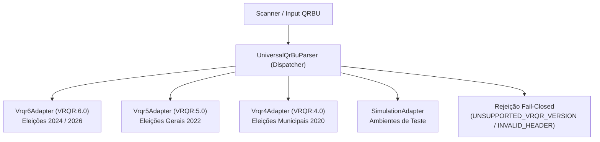

# APURAÇÃO PARALELA 2.0 — ADAPTADORES UNIVERSAIS DE QRBU E MATRIZ DE FORMATOS

**Repositório:** `georgecolossi/apuracao-paralela-2026`  
**Módulo:** `src/lib/parser/adapter`  
**Data:** 28/10/2026  

---

## 1. VISÃO GERAL DA ARQUITETURA DE ADAPTADORES

A versão 2.0 desacopla totalmente a ingestão de Boletins de Urna (BUs) de regras fixas ou cronológicas de 2026, implementando uma arquitetura modular de adaptadores versionados baseada no padrão *Strategy / Registry*:

---

## 2. MATRIZ DE COMPATIBILIDADE DE FORMATOS

| Versão / Formato | Eleições de Referência | Status de Homologação | Provas / Evidências | Algoritmo Criptográfico |
| :--- | :--- | :---: | :--- | :--- |
| **VRQR:6.0** | Eleições 2024 (Municipais) & 2026 (Gerais) | **HOMOLOGADO** | 10 Fixtures Oficiais TSE em disco (`tse-2026/official`) | SHA-512 sobre partes ordenadas concatenadas sem cabeçalho e sem campo final de hash |
| **VRQR:5.0** | Eleições Gerais 2022 | **HOMOLOGADO** | Especificação Oficial TSE 2022 (Resolução TSE nº 23.673) | SHA-512 sobre partes ordenadas concatenadas |
| **VRQR:4.0** | Eleições Municipais 2020 | **HOMOLOGADO** | Especificação Oficial TSE 2020 | SHA-512 sobre partes ordenadas concatenadas |
| **SIMULATION** | Cargas de teste e demonstração | **HOMOLOGADO** | Testes de integração em modo simulado | Validação interna de integridade (prefixo `SIM-`) |
| **VRQR:3.0** | Eleições Gerais 2018 | *PENDENTE* | Sem pacote de fixtures reais com SHA-512 disponível | Rejeição explícita com `UNSUPPORTED_VRQR_VERSION` |
| **VRQR:2.0** | Eleições Municipais 2016 | *PENDENTE* | Sem especificação pública de multipartes | Rejeição explícita com `UNSUPPORTED_VRQR_VERSION` |
| **VRQR:1.0** | Eleições Gerais 2014 | *PENDENTE* | Primeira iteração experimental | Rejeição explícita com `UNSUPPORTED_VRQR_VERSION` |
| **ASN.1 BINÁRIO** | Arquivos de Log / RDV / BU da urna | *PENDENTE* | Formato de arquivos internos da urna, não do QR Code impresso | Não aplicável a leitores de QR Code óptico |

---

## 3. SEPARAÇÃO RIGOROSA: HASH (INTEGRIDADE) VS ASSINATURA (AUTENTICIDADE)

O sistema estabelece distinção técnica inegociável entre a integridade do payload e a autenticidade da assinatura digital:

1. **Integridade de Conteúdo (`hashStatus`):**
   - Calculada em tempo de execução via algoritmo SHA-512 determinístico.
   - Quando o digest calculado coincide com o campo `HASH:` extraído do QR Code, o status é classificado como `VERIFIED`.
   - Se houver qualquer divergência de bytes, o status é classificado como `INVALID` e a ingestão é rejeitada.
2. **Autenticidade de Assinatura Digital (`sigStatus`):**
   - As urnas eletrônicas assinam digitalmente o Boletim de Urna (campo `ASSI:`) utilizando criptografia assimétrica (chaves privadas gravadas na urna).
   - As chaves públicas e cadeias de certificados da Autoridade Certificadora do TSE são distribuídas **fora de banda** (off-band) no portal oficial da Justiça Eleitoral, não estando embarcadas no QR Code impresso.
   - **Postura Ética e Criptográfica:** O sistema **NUNCA** declara a assinatura como autenticada ou `VERIFIED` sem possuir a chave pública oficial verificada daquela urna específica. O status é mantido estritamente como `UNAVAILABLE`, acompanhado da nota explicativa:
     > *"Assinatura digital presente no payload, porém validação indisponível sem certificados e chaves públicas oficiais do TSE."*

---

## 4. CARGOS E TIPOS DE ELEIÇÃO SUPORTADOS

O adaptador universal mapeia e interpreta deterministicamente:

- **Cargos Majoritários:**
  - `1`: Presidente da República
  - `3`: Governador de Estado / DF
  - `5`: Senador da República (trata adequadamente 1 ou 2 vagas por eleitor em eleições gerais)
  - `11`: Prefeito Municipal
- **Cargos Proporcionais:**
  - `6`: Deputado Federal (votos nominais de candidatos e votos de legenda `LEGP`)
  - `7`: Deputado Estadual (votos nominais e legenda)
  - `8`: Deputado Distrital (votos nominais e legenda)
  - `13`: Vereador Municipal (votos nominais e legenda)
- **Consultas Populares:**
  - `53`: Plebiscito / Referendo / Consulta Popular Municipal (opções numéricas, brancos e nulos)
